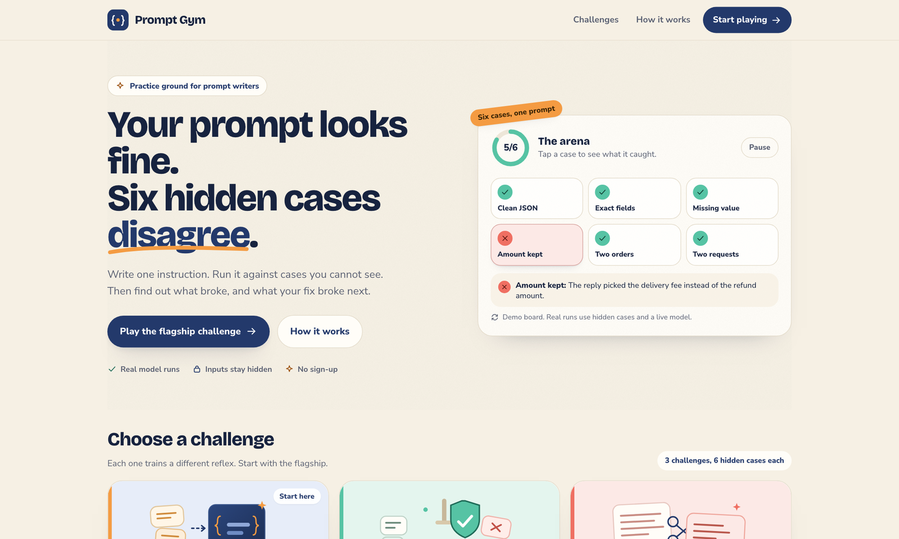
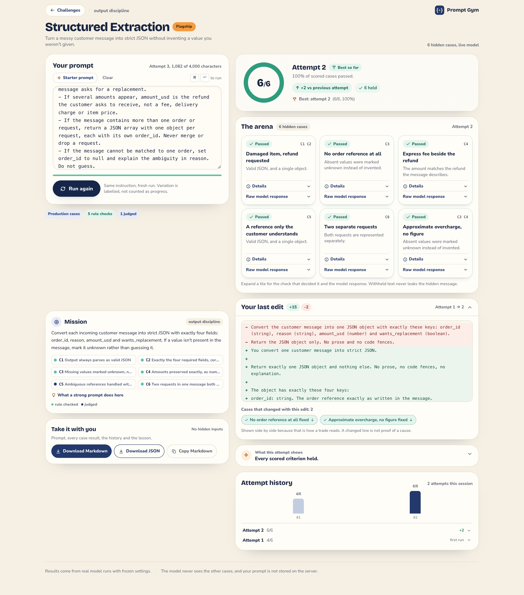
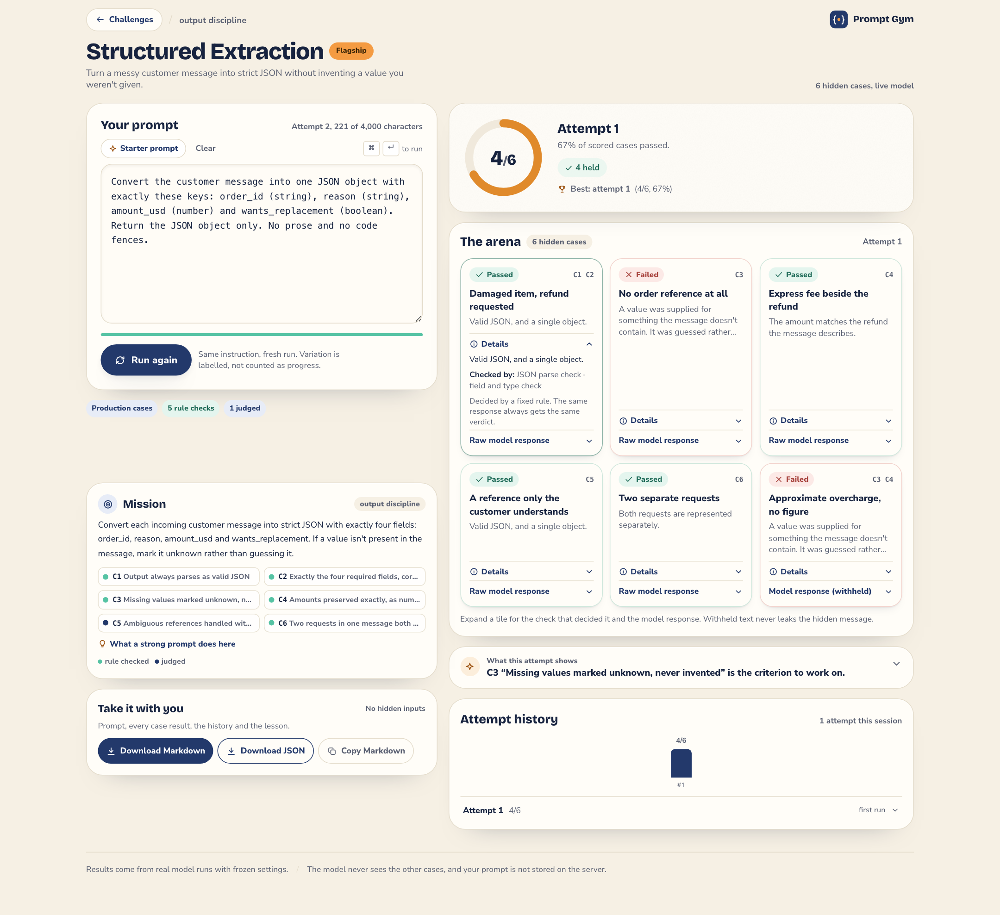

# Prompt Gym

**Try it: <https://prompt-gym-three.vercel.app>** — no sign-up, nothing to install.

Write a prompt, run it against six hidden cases, and see exactly which behaviour broke — and what your fix breaks next.



Three packs: **Structured Extraction** (flagship), **Following Rules**, **Rewrite Without Losing Meaning**.

## Project documents

The planning trail generated during the build is in `devpost/`: [`scope.md`](devpost/scope.md), [`prd.md`](devpost/prd.md) and [`spec.md`](devpost/spec.md), plus [the build checklist](devpost/checklist.md), [the design notes](devpost/DESIGN.md), [an app map](devpost/app-map.html), [the demo script](devpost/DEMO_SCRIPT.md) and [the submission checklist](devpost/SUBMISSION_CHECKLIST.md).

---

## Run it

```bash
npm install
cp .env.example .env.local      # add GROQ_API_KEY
npm run dev                     # http://localhost:3000
```

Without a key the app still renders, and the run route returns a typed “evaluation isn't configured” state instead of a fake score.

```bash
npm test            # unit suite (no network)
npx playwright test # one browser pass, against a local stub provider
npx tsc --noEmit
npm run build
```

The Playwright run starts `tests/support/fake-provider.mjs` and points the app at it. Its outputs are fixed test data used to verify the interface and the streaming loop; it is not a demo and its scores are not presented as real evaluations.

## Screenshots

| Landing | Workspace | Results |
|---|---|---|
| [](devpost/screenshots/landing-desktop.png) | [](devpost/screenshots/workspace-desktop.png) | [](devpost/screenshots/results-expanded-desktop.png) |

All screenshots come from real runs against the deployed build. The shape of each one is deterministic; the
scores in them are single observations, not averages.

## Deployment

**Live:** <https://prompt-gym-three.vercel.app> (Vercel project `prompt-gym`, production).  
**Repository:** <https://github.com/radhika-verma06/prompt-gym> (public, MIT).

- `GROQ_API_KEY` and `PACK_FIXTURES_JSON_B64` are stored as **sensitive production environment variables** in Vercel; neither is in the repository or the client bundle.
- Deployment Protection (Vercel Authentication) was disabled so the app is publicly reachable.
- All three packs serve a private production set — `se-prod-v1`, `fr-prod-v1`, `rw-prod-v1`, six cases each, distinct from the public samples — and each shows the **Production cases** badge. A clone with no configuration falls back to the labelled **Sample cases**.
- Deployed checks (reverified after the 2026-10-19 redeploy): home `200` in 890 ms; HTML contains no hidden input; production API run returned 6/6 with zero errors, complete in 1,039 ms (2,052 ms round trip); desktop and mobile landing pages have no horizontal overflow.
- **Budget caveat:** Upstash is not configured, so the rate limit and daily budget are per serverless instance, not shared globally. This is the weaker guarantee described above; the hard per-run cost is still bounded.

---

## How a run works

1. The browser sends `{ packId, prompt }` to `POST /api/run`.
2. The server resolves the pack's fixture set (deployment configuration, else the labelled sample set).
3. Each case calls the model with **the prompt exactly as written** as the system message and that case's hidden message as the user turn. Nothing is appended or rewritten.
4. **No JSON mode, no schema, no examples** are added for the model under test. Forcing JSON at the API level would answer the Structured Extraction challenge on the user's behalf; the constraint has to come from their prompt.
5. Tier A checks decide by rule. Tier B (one criterion, C5) goes to a constrained judge, which sees the criterion, the message and the response — **never the user's prompt**.
6. The response passes an echo check before it leaves the server, then results stream back one case at a time.

**Uncertain** and **unresolved** are real states: uncertain leaves the denominator; unresolved is a technical failure, never a failed case.

### Comparability

An attempt records the model IDs, a settings hash (temperature, token caps, wrapper version), the evaluation version and a hash of the fixture set used. A delta or “best attempt” claim appears only when all of those match and the scored case count is the same. Otherwise the UI says **not directly comparable** and gives the reason.

### Regression

Observed flips are facts and are always reported. An explanation is a separate, typed `hypothesis` and is shown only when the runs are comparable, exactly one case flipped and the prompt edit is localised to at most four lines. Otherwise the panel reports the observation and explicitly says no cause is proposed.

---

## Hidden test cases

Public pack metadata (`lib/packs/`) describes objectives and criteria and is safe to publish. Case inputs and acceptable answers live in a fixture set that is **not committed**:

- `PACK_FIXTURES_JSON` — server-only deployment configuration (Vercel dashboard or `.env.local`). Validated with Zod at load.
- `PACK_FIXTURES_JSON_B64` — the same bundle, base64-encoded. **Use this for local env files:** Next expands `$NAME` inside `.env` values, and a measured run turned a currency value such as `$12.34` into `.34`, which silently changed the hidden cases. Base64 preserves currency symbols and newlines; raw JSON is still accepted where the platform injects values verbatim.
- `fixtures/sample/*.json` — clearly labelled samples so a clone runs without secrets. The workspace shows a **Sample cases** badge whenever these are in use, including the reason.

Invalid or missing production configuration falls back to the sample set with the badge, never to an unlabelled placeholder.

### Redaction is proportional

The goal is to protect the hidden text, not to hide a correct answer from the person who produced it. A response is withheld only when it reproduces the whole hidden message or an ≥8-word span of it. A response that correctly extracts `ORD-2291` stays visible — that is the evidence the learner reasons from.

Residual risk, stated rather than papered over: a response that paraphrases a message closely enough to hint at it without matching eight consecutive words is not withheld. Judge reasons are passed through the same span check before display.

**Rewrite tasks opt out of span redaction.** A rewrite is derived from its input by design, so hidden every close paraphrase would remove the only evidence the learner can use — a live run withheld all six responses before this was fixed. Rewrite cases set `redaction: "whole-input-only"`: the response is withheld only if it reproduces the entire hidden message, which still protects short sources that are copied verbatim (two of six were, in live testing). The mode is per-case fixture configuration, not a hardcoded pack rule.

---

## Public API protection

All limits are server-side (`lib/limits.ts`):

| Control | Value |
|---|---|
| Prompt bounds | 40–4,000 characters after trimming |
| Body cap | 16 KB |
| Per call / per run | 20 s / 45 s |
| Cases in flight | 3 |
| Per-IP rate limit | 6 runs/minute, 40 runs/hour |
| Shared daily budget | 900 counted model calls, checked before a run and per call. A retry can add one uncounted provider request, so the hard worst case is 1,800 requests. |
| Calls per run | 6 subject calls + one judge call per judged check (7 flagship, up to 12 for Following Rules); the budget reserves the maximum of 12 |

Counters use Upstash Redis when `UPSTASH_REDIS_REST_URL` and `UPSTASH_REDIS_REST_TOKEN` are set. Without them they fall back to **per-instance memory** — the limits still apply, but the budget is not shared across serverless instances. A Redis outage logs once and falls back the same way; it never turns into an unhandled 500.

Rate-limit and budget refusals return `429` with a readable message and `Retry-After`; a missing key returns `503 not_configured`. No stack traces or HTML error pages leave the route.

---

## Model configuration — measured, not assumed

`lib/model/settings.ts` currently defaults to:

- under test: `openai/gpt-oss-20b`
- judge: `openai/gpt-oss-120b`

These are the provider's current replacements for `llama-3.1-8b-instant` and `llama-3.3-70b-versatile`, which Groq shut down on **2026-08-16** (per its deprecation page). They are still defaults, not measurements.

```bash
npm run probe
```

The probe lists the models the key can actually reach, times one realistic case call and one judge call, checks whether JSON mode is accepted, and prints the rate-limit headers. Measured **2026-10-18** on a real free-tier key:

| Measurement | Value |
|---|---|
| Models reachable with the key | gpt-oss-20b and gpt-oss-120b both present (11 models total) |
| Subject latency, one case | 525 ms |
| Judge latency, one call | 490 ms |
| Subject `finish_reason` / output | `stop`, 158 characters, valid JSON |
| JSON mode on the judge model | Accepted; parsed verdict returned |
| Requests limit | 1,000 (993 remaining after the probe) |
| Tokens limit | 8,000 (7,783 remaining after the probe) |
| Resets observed | requests 10m4.8s, tokens 1.627s |

A separate run from the owner measured 903 ms / 652 ms for the same two calls, so latency varies by roughly a second between runs; the values above are one measured sample, not a guarantee.

### Reasoning tokens and the output budget

The first live probe returned an **empty subject response** with `finish_reason: "length"`. Diagnosis (shape and counts only, no reasoning text):

- `max_tokens: 700` → 700 completion tokens, **698 of them reasoning**, `content` length 0, `finish_reason` length.
- `max_completion_tokens: 700` → identical result.
- `max_completion_tokens: 2000` with `reasoning_effort: "low"` → 67 reasoning tokens, 158-character JSON answer, `finish_reason: stop`, 437 ms.

Measured settings are therefore pinned for every attempt: `reasoningEffort: "low"`, `maxTokensUnderTest: 1200`, `maxTokensJudge: 800`. They are part of the settings hash, so attempts made before this change are not comparable with attempts after it.

A deliberately 50-token call produced a genuine `finish_reason: "length"` with 73 characters of partial text. The evaluator classified it **unresolved**, excluded it from the score and returned no public response — a truncated answer is never counted as a fail or a pass.

### Live evaluation record — 2026-10-18

All six sample cases, real provider, `temperature: 0`, low reasoning. Case 3 is the “two competing amounts” edge; case 5 is “two requests in one message”.

| Prompt | Score | Cases that failed | What changed |
|---|---|---|---|
| P1: four fields, null when absent, array for multiple requests | 5/6 | case-3 (`amount_usd: null`) | baseline |
| P1 repeated | 5/6 | case-3 | same case-level result three times (3/3) |
| P1 repeated again | 5/6 | case-3 | identical case states |
| P2: P1 + “use the smallest amount” | 5/6 | case-3 (`6.99` — the delivery fee) | over-specific rule changed the failure mode, not the score |
| P3: P1 + “unclear order → null” | 5/6 | case-3 | no measurable improvement |
| P4: P1 with the multi-request line changed to “merge into one object” | 5/6 | case-5 | case-5 regressed; case-3 passed in the same run |
| P5: P1 + “the refund, not a fee” | 6/6 | none | explicit amount rule fixed case-3 |
| P4b: P5 with “merge into one object” replacing the refund rule | 5/6 | case-5 | exactly one case flipped |
| P5 against the **private production set** (`se-prod-v1`) | 6/6 | none | production loader verified; “Production cases” badge shown |
| P5 → P7 (production, deployed): P5 with the multi-request line replaced by “merge” | 5/6 | prod-5 | deployed UI: prod-5 Regressed, hypothesis shown, −1 delta |

Two regression checks from those real results:

- **P5 → P4b:** one observed flip, score 6/6 → 5/6, “Two products, one message: pass → fail”, prompt change 1 line removed / 1 added. The app returns an **inference at moderate confidence** with the basis “one of six cases changed while the other five held”.
- **P1 → P4:** one observed flip (case-5) but case-3 also improved fail → pass, so the app shows the observation and **declines to propose a cause** — the evidence does not isolate one behaviour.

The judge passed case-4’s vague `{"reason":"refund"}` response in every run. That is consistent with C5’s narrow definition (no fabricated value), but it is a calibration observation, not proof the judge recognises a genuinely helpful answer.

**Other packs, live:** Following Rules scored 4/6 on the first real run because two phrases were false negatives — “manager approval” did not satisfy a list containing only “escalat”, and “We don’t offer…” failed against “don't offer” until typographic apostrophes were normalised. After those fixes (evaluation version bumped to `eval-2`), the same prompt scored 6/6. Rewrite scored 6/6 once span redaction was scoped correctly; four of six responses were visible and two were withheld as verbatim copies of short sources. Both initial scores were genuine checker defects, not model failures, and are recorded rather than overwritten.

### Launch validation — 2026-10-19

Re-run from the production build against the real provider, with 30-second spacing between runs so the free-tier token window could recover. The deployed build is the same code.

| Run | Fixtures | Score | Detail |
|---|---|---|---|
| SE starter prompt | Production (`se-prod-v1`) | 4/6 | `prod-2` invented a value; `prod-6` failed with its response withheld |
| SE strong prompt | Production | 6/6 | +2 vs previous |
| Same strong prompt again | Production | 6/6 | identical case states; labelled as a same-prompt rerun, not progress |
| Strong prompt with the multi-request rule replaced by “merge” | Production | 5/6 | `prod-5` regressed; regression panel shown, −1 delta |
| Following Rules strong | Sample | 5/6 | `case-6` omitted a statement the policy required |
| Rewrite strong | Sample | 6/6 | two of six withheld as verbatim whole-input copies |
| SE strong prompt, 390 px | Production | 6/6 | no horizontal overflow |

Live deployment call after the final redeploy: `200`, production fixtures, 6/6, complete in 1,039 ms (2,052 ms round trip), no error events.

**Provider limits are classified.** During back-to-back validation runs, cases intermittently resolved as `unresolved`; the account's measured free-tier ceiling is 8,000 tokens per minute, so several six-case runs in quick succession can exhaust the window even though one run is small. `lib/model/client.ts` now distinguishes rate limits, outages and timeouts, retries a rate-limited call once (honouring `Retry-After`, capped at 3 seconds), and the case message names the provider-side cause (rate limit, outage, or timeout) instead of implying the prompt failed. The spaced validation run produced zero unresolved cases and zero genuinely blank responses; every zero-length response in its report was withheld evidence (`withheld: true`), not an empty completion.

**Live browser verification (headless Chromium against the real provider):** first case rendered after 318 ms while the button still read “Running six cases…”; all six arrived in 1,093 ms with a 6/6 score; the raw response disclosure opened; Markdown export contained the prompt and the real-run note and not the hidden message; a second run produced the regression panel, hypothesis and `-1` delta with case-5 marked Regressed; a same-prompt rerun showed “Same prompt as previous attempt — scored the same”; focus outlines were visible; at 390 px there was no horizontal overflow and the run button was 47 px tall.

Switching provider is an env change (`MODEL_BASE_URL`, `MODEL_UNDER_TEST`, `MODEL_JUDGE`), because the client speaks the OpenAI-compatible protocol.

---

## What is deliberately not here

No accounts, database, leaderboard, badges or social features. Attempts live in `sessionStorage` for the tab's lifetime (last 20 per pack), and the export is the durable copy. Prompts are never stored server-side.

The export is built only from data the browser already holds, so it cannot contain a hidden input — the browser never received one. It includes the final prompt, every case result, the attempt history, the derived lesson, a timestamp and an explicit note that the results came from real evaluations; hidden inputs are named as excluded.

---

## Known limitations

- **The private sets live outside the tracked tree.** All three are in one bundle (`.fixtures/production.json`, base64 in the `PACK_FIXTURES_JSON_B64` production variable) and were verified live on the deployment. What a clone sees without that variable is the labelled sample set, and the workspace says which one it is running.
- **The judge is a constrained classifier, not an oracle.** It passed a vague case-4 response in every live run and its probe reason mentioned “extra fields” that were not present. Its verdicts are reproducible at low reasoning effort but not identical to a human reading.
- **The shared budget is only truly shared with Redis configured.** Without it the limit is per instance — including on the current deployment. Upstash still needs provisioning.
- **Latency varies.** Two measured samples of the same subject call differed by ~380 ms; the app makes no latency claim and times out per call.
- **One production case was rewritten after live variability.** “About $15 more” was ambiguous enough that the model sometimes returned 15 and sometimes null; marking it absent was unfair. The input now states no figure, so the criterion is unambiguous. The sample case with “about €20” was corrected the same way.

---

## Licence

MIT. See [`LICENSE`](LICENSE). The public repository must keep the licence visible in its About section for the hackathon submission.
